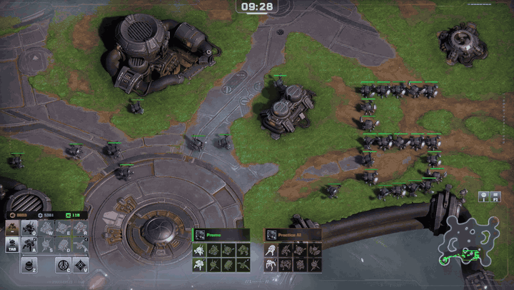
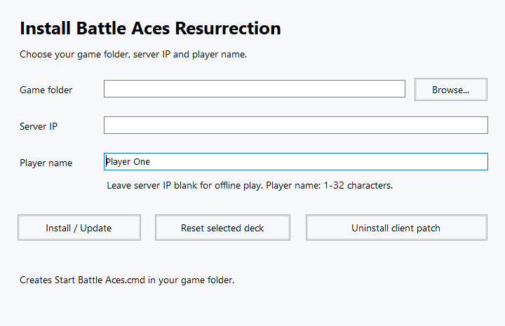
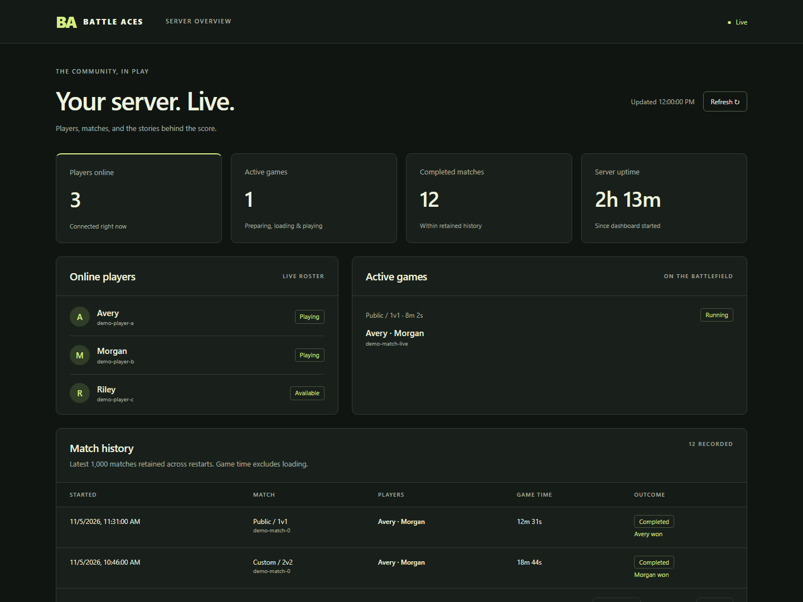

# Battle Aces Resurrection

A community server and reversible Windows client patch for **Battle Aces build 37822**. Play against local AI, host private matches, or join a community server using your own game installation.

**Current download:** [Battle Aces 0.3.0-rc1.7 client and server installers](https://github.com/Vegasq/battleaces_resurrection/releases/tag/v0.3.0-rc1.7) · Windows x64 · Engineering prerelease

The installers contain our client and server software. **They do not contain the original game files.** Keep an untouched copy of your supported game installation for recovery.

## Install the client

1. Close Battle Aces. Download **BattleAces-Client-Installer-0.3.0-rc1.7.exe** from the release above.
2. Open the installer and select your working Battle Aces folder—the one containing `Battle Aces.exe`. Enter your player name and the host's IP address. Leave the address blank to play offline against AI.
3. Click **Install / Update** and wait for the installed message. Verifying the game files can take several minutes.
4. In the **game folder**, open **Start Battle Aces.cmd** whenever you want to play. You do not need to keep the downloaded installer or install Python.

*The native client installer. The screenshot uses example settings.*

From the game menu, **Try Deck** starts a local AI game. Public 1v1, 2v2 and 2vAI queues use available players and fill open seats with AI after 30 seconds. **Custom** rooms are for human players. To open a saved replay, close the game and use **Watch Replay.cmd** in the game folder.

## Host a server

1. Download **BattleAces-Server-Installer-0.3.0-rc1.7.exe** from the **same release**. Close the game and any server you are replacing.
2. Select your supported build 37822 game folder and a **new, empty server folder**. The installer makes a private working copy while importing local game data, so allow space for roughly one full game copy during setup. It does not change the source game.
3. Open **Start Server.exe** in the new server folder. On first start it creates its local configuration and private certificate, then listens for players on **TCP 47623**. Stop it with **Ctrl+C** in its console.
4. Give players the server's LAN or public IP address. For Internet play, allow and forward **TCP 47623** to the host. Players enter that IP in the client installer.

Start the host before updating clients. The server installer requires an empty destination; keep your existing host's `config/`, `data/`, private keys and imported `assets/` when planning a move or update. See the [Windows server guide](docs/windows-server-quickstart.txt) for setup details.

### Server dashboard

While the host runs, open **http://127.0.0.1:47624** on the server PC to see online players, active games and match history. It is local to the host by default. The dashboard has no login, so expose port 47624 only if you intend to make those names and match summaries public. Gameplay uses the separate TCP 47623 port.

*Example dashboard using demo data; no real player records are shown.*

## Keep your progress

The client stores profiles, selected decks, cosmetics, original-file backups and server identity files under `.battleaces-resurrection/` in the game folder. **Back up that whole directory privately** before moving or reinstalling the game. An update preserves it. Changing the server address, port or local profile selects a different player identity; return to the original settings to use the original identity.

For a server, keep `config/` (including `config/private/`), `data/` and imported `assets/` together. The server's player identities and match history live in its data directory. Do not overwrite an existing host with the installer.

## Project status and guides

This is an **engineering prerelease**. D5 privacy acceptance and the final release gates remain open; `RUNTIME_VALIDATED` is false. The [release record](docs/coherent-candidate557.txt) lists the exact hashes and checks. The [roadmap](docs/REMAINING_DELIVERY_PLAN.txt) tracks remaining work.

| Guide | Use it for |
| --- | --- |
| [Windows client](docs/windows-client-quickstart.txt) | Settings, replay, update, restore and identity details |
| [Windows server](docs/windows-server-quickstart.txt) | Hosting, certificates, data and advanced setup |
| [Dashboard](docs/server-dashboard175.txt) | Access, history retention and configuration |
| [Linux/Wine server](docs/linux-server-quickstart.txt) | Experimental headless hosting and copied-host relocation |
| [Developer reference](README.txt) | Source layout, builds and tests |

Repository source does not include the original game's assets, certificates, keys or player profiles.
