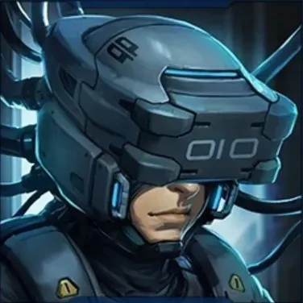

# Battle Aces Resurrection

A community server and reversible Windows client patch for **Battle Aces build 37822**. Play against local AI, host private matches, or join a community server using your own game installation.

**Download 0.4.0:** [Client installer](https://github.com/Vegasq/battleaces_resurrection/releases/download/v0.4.0/BattleAces-Client-Installer-0.4.0.exe) · [Server installer](https://github.com/Vegasq/battleaces_resurrection/releases/download/v0.4.0/BattleAces-Server-Installer-0.4.0.exe) · [Release notes](https://github.com/Vegasq/battleaces_resurrection/releases/tag/v0.4.0) · Windows x64

**Community server:** Public queues and Custom rooms on **134.209.176.39:47623** are open again for 0.4.0 players. The dashboard remains restricted to the project owner's IP. Solo AI runs locally by default; movement and latency in games with other humans remain under evaluation.

<a href="https://discord.gg/s8YM4d2Sf"></a> **Community:** [Join the Discord server](https://discord.gg/s8YM4d2Sf) to chat with other players and find matches.

The installers contain our client and server software. **They do not contain the original game files.** Keep an untouched copy of your supported game installation for recovery.


## Check that your game copy is supported

This patch supports the **Windows x64 Battle Aces build 37822** files. Before installing:

1. Find your own game folder. It must contain `Battle Aces.exe` and `GameAssembly.dll`. Keep a separate untouched copy for recovery; choose a writable working copy in the installer.
2. Open PowerShell and check the original DLL, replacing the example folder with yours:

   ```powershell
   (Get-FileHash -Algorithm SHA256 -LiteralPath 'D:\BattleAces\GameAssembly.dll').Hash
   ```

   The supported original `GameAssembly.dll` hash is `e59d08c01479b27404778048d7e13546dbf3771f6b3912744c7c2bdf80c4e758` (letter case does not matter).
3. If this working copy already has our patch, check `.battleaces-resurrection/original/GameAssembly.dll` in that same game folder instead. The active DLL is patched and has a different hash.
4. Select the working copy in the installer. It checks the original components and local asset bundles before completing the patch. If verification fails, use a complete, unmodified build 37822 copy; do not mix files from different builds.

## Install the client

1. Close Battle Aces. Download **BattleAces-Client-Installer-0.4.0.exe** from the release above.
2. Open the installer and select your working Battle Aces folder—the one containing `Battle Aces.exe`. Enter your player name. The server IP defaults to **134.209.176.39** on new installs; keep it for the community server or replace it for another host. Existing saved addresses load when you select their game folder. Solo AI runs locally without clearing the server IP; a blank IP also supports offline play.
3. Click **Install / Update** and wait for the installed message. Verifying the game files can take several minutes.
4. Use the **Battle Aces Resurrection** desktop shortcut, or open **Start Battle Aces.cmd** in the game folder. You do not need to keep the downloaded installer or install Python.

The client starts fullscreen. To start in a window, close the game and set `"fullscreen": false` in the game folder's `.battleaces-resurrection/client-config.json`; installer updates keep that choice.


*The native client installer. The screenshot uses example settings.*

From the game menu, **Try Deck** starts a local AI game immediately. Public **1v1, 2v2 and 2vAI** search for human players for up to **30 seconds**, then fill open seats with AI. In **2vAI**, this gives another human time to join as your co-op teammate. If you are the only human, the game runs on your PC by default. A match containing other humans stays on the server. **Custom** rooms are for human players. To open a saved replay, close the game and use **Watch Replay.cmd** in the game folder.

To choose server-hosted solo AI, close the game and set `"solo_ai_host": "server"` in `.battleaces-resurrection/client-config.json`; `"local"` restores the default. Updates keep this choice. Local games do not appear in server match history. Use the matching 0.4.0 host for the public queue handoff.

If an update warning appears in the game, close it and run the latest client installer's **Install / Update** on the same game folder. The update keeps your saved choices and identity.

## Host a server

1. Download **BattleAces-Server-Installer-0.4.0.exe** from the **same release**. Close the game and any server you are replacing.
2. Select your supported build 37822 game folder and a **new, empty server folder**. The installer makes a private working copy while importing local game data, so allow space for roughly one full game copy during setup. It does not change the source game.
3. Use the **Battle Aces Server** desktop shortcut, or open **Start Server.exe** in the new server folder. On first start it creates its local configuration and private certificate, then listens for players on **TCP 47623**. Stop it with **Ctrl+C** in its console.
4. Give players the server's LAN or public IP address. For Internet play, allow and forward **TCP 47623** to the host. Players enter that IP in the client installer.

Start the host before updating clients. The server installer requires an empty destination; keep your existing host's `config/`, `data/`, private keys and imported `assets/` when planning a move or update. See the [Windows server guide](docs/windows-server-quickstart.txt) for setup details.

### Server dashboard

While the host runs, open **http://127.0.0.1:47624** on the server PC to see online players, active games and match history. It is local to the host by default and has no login; keep remote access limited to trusted IPs. The community server's dashboard remains restricted to the project owner's IP. Gameplay uses the separate public TCP 47623 port.


*Example dashboard using demo data; no real player records are shown.*

## Keep your progress

The client stores profiles, selected decks, cosmetics, original-file backups and server identity files under `.battleaces-resurrection/` in the game folder. **Back up that whole directory privately** before moving or reinstalling the game. An update preserves it. Changing the server address, port or local profile selects a different player identity; return to the original settings to use the original identity.

For a server, keep `config/` (including `config/private/`), `data/` and imported `assets/` together. The server's player identities and match history live in its data directory. Do not overwrite an existing host with the installer.

## Project status and guides

Version **0.4.0** adds local solo AI by default, online frame pacing improvements and a fix for disconnects caused by empty selection commands. Online movement and latency evaluation, D5 privacy acceptance and final release gates remain open; `RUNTIME_VALIDATED` is false. See the [0.4.0 release notes](https://github.com/Vegasq/battleaces_resurrection/releases/tag/v0.4.0) and [roadmap](docs/REMAINING_DELIVERY_PLAN.txt) for scope and remaining work.

| Guide | Use it for |
| --- | --- |
| [Windows client](docs/windows-client-quickstart.txt) | Settings, replay, update, restore and identity details |
| [Windows server](docs/windows-server-quickstart.txt) | Hosting, certificates, data and advanced setup |
| [Dashboard](docs/server-dashboard175.txt) | Access, history retention and configuration |
| [Linux/Wine server](docs/linux-server-quickstart.txt) | Experimental headless hosting and copied-host relocation |
| [Developer reference](README.txt) | Source layout, builds and tests |

Repository source does not include the original game's assets, certificates, keys or player profiles.
